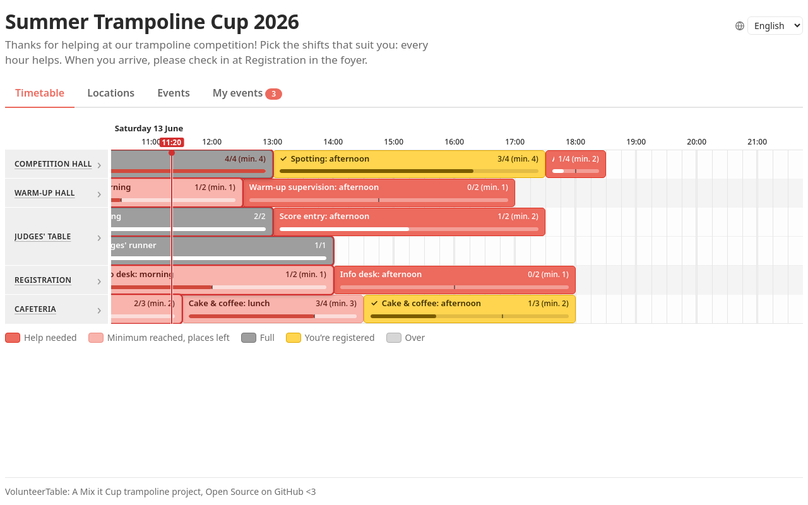
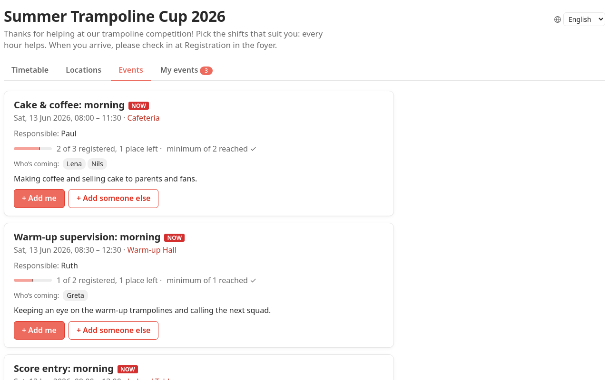
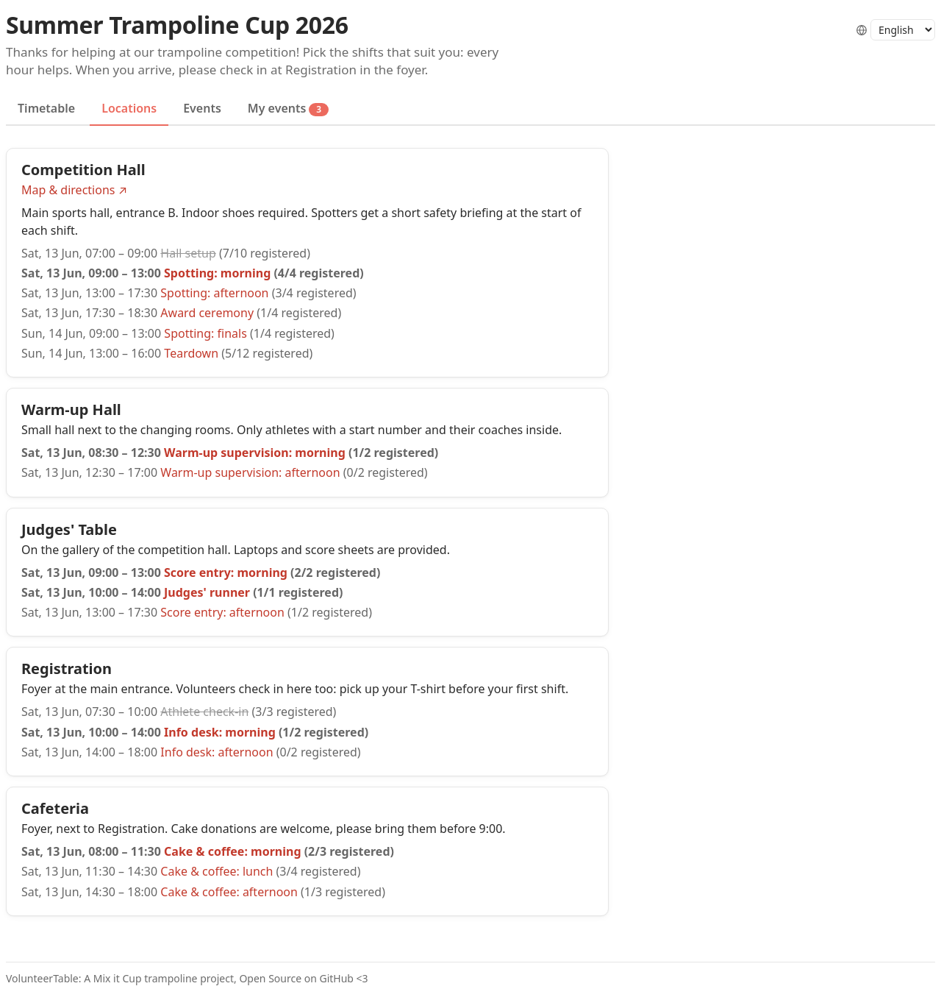
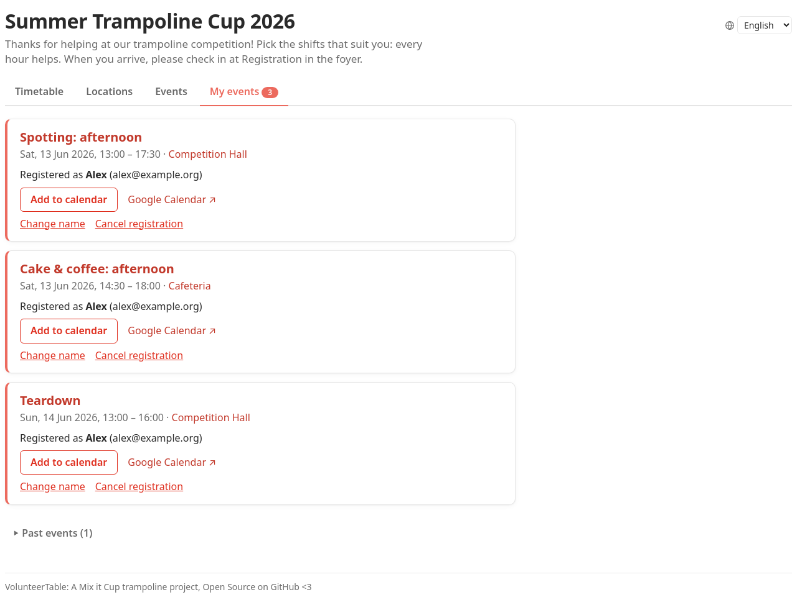
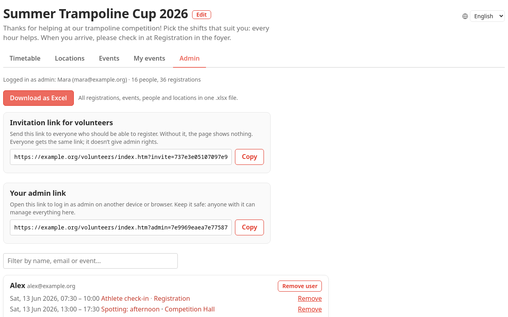
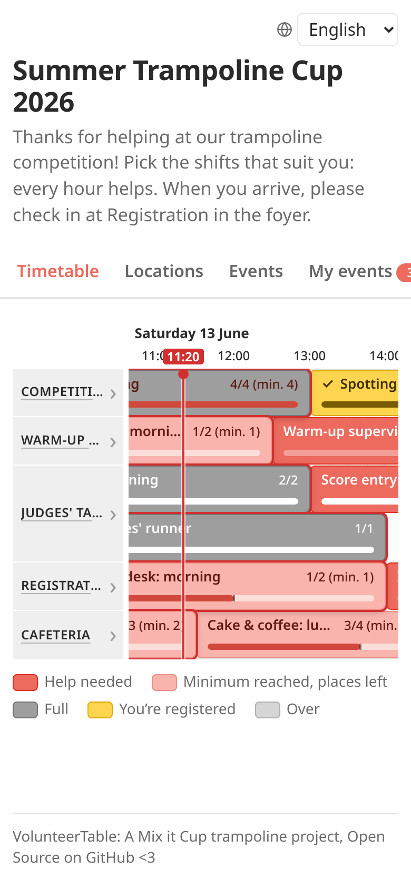

VolunteerTable
===

There are a few volunteer web tools, but we wanted something that is both very easy to use and has a timeline view and the option to provide details to events. This tool fulfills that.

It can also be used as a booking tool for other events.

## Screenshots

The following screenshots show an imaginary trampoline event (invented by Claude Code).



| Events | Locations |
|---|---|
|  |  |

| My events | Admin |
|---|---|
|  |  |



## Setup

The project has two folders:

- `public/` – the web page and API. Only this folder should be reachable from the web.
- `private/` – code, configuration, example data and (with SQLite) the database.

To deploy, symlink `public/` into your web server's folder and keep `private/` next to the real `public/` folder:

```sh
ln -s /path/to/volunteertable/public /var/www/html/volunteers
```

The API finds `private/` through the symlink. If you copy `public/` instead, set the environment variable `VOLUNTEERTABLE_PRIVATE_DIR` to the `private/` folder.

Copy `private/config.example.php` to `private/config.php` and adjust the database, `base_url` and mail settings. Requires PHP 7.4 or newer with PDO.

To check a deployment, run `php private/check.php` on the server: it tests the configuration, database and mail settings and prints what is wrong. Errors of the running app are written to the PHP error log, starting with `[volunteertable]`.

The database can be configured like in the [Engelsystem](https://engelsystem.de/doc/admin/configuration/): with a `'database' => ['driver', 'host', 'database', 'username', 'password']` block in `config.php`, or with the environment variables `MYSQL_TYPE`, `MYSQL_HOST`, `MYSQL_DATABASE`, `MYSQL_USER` and `MYSQL_PASSWORD`. All tables start with `vt_`, so an Engelsystem database can be shared. Without any database configuration, a SQLite file in `private/data/` is used.

For local testing:

```sh
php -S localhost:8000 -t public
```

Then open http://localhost:8000/index.htm. The first visitor becomes admin and gets the invitation link for volunteers on the Admin tab.

## Screenshots

The screenshots above are generated from example data in `tools/screenshots/demo/` (a fictional one-weekend trampoline competition). The script starts a throwaway copy of the app with its own SQLite database in a temporary folder, registers an example volunteer for a few shifts and takes the screenshots with a headless browser, with the clock fixed to the competition's Saturday morning. Your `config.php` and database are not touched. It needs PHP and Node.js:

```sh
cd tools/screenshots
npm ci
npx playwright install chromium
npm run screenshots
```

The images are written to `screenshots/`. Set `PHP=/path/to/php` if `php` is not on the path, or `PORT` if port 8790 is taken. Fonts come from the system, so the images can look slightly different on another computer.

## Translations

The page is available in English and German; visitors get their browser's language and can switch in the top-right corner. Texts are referred to by key and kept in one file per language:

- `public/lang/en.js`, `public/lang/de.js`: the page.
- `private/lang/en.php`, `private/lang/de.php`: the emails.

To change a text, edit it in the file of that language. To add a language, copy the English files (e.g. to `public/lang/fr.js` and `private/lang/fr.php`), translate the texts, and load the new page file in `public/index.htm` after `lang/de.js`. Missing texts fall back to English.

## Thanks

This tool is initially based on https://github.com/Grible/timetable.js and extended using GitHub Copilot and Claude Code.